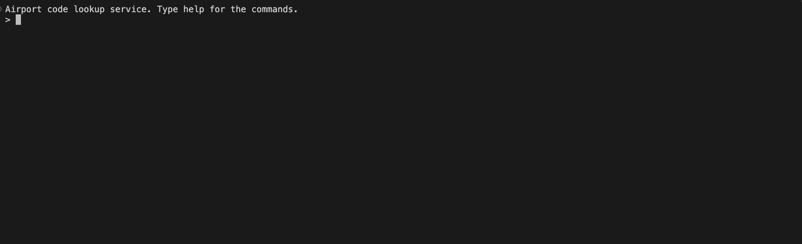

# airport-bst-cpp

A lookup service for airport codes, built on a binary search tree written from
scratch in C++.

# Karishma Premnath and Mithila Krishna Shashikala

### EECE 7205 Mini Project

## The problem

Every boarding pass and baggage tag identifies an airport by its three-letter
IATA code: BOS for Boston Logan, JFK for New York Kennedy, DAC for Dhaka. A
travel company needs a service that takes a code and returns the airport's name,
city, country and position, and that stays correct while airports are added and
removed. Agents also need alphabetical listings and range queries such as every
code from BOS to BWI.

The service is keyed by IATA code and loaded with 6,072 real airports.

## Build and run

```
g++ -std=c++17 -O2 src/*.cpp -o airports
./airports
```

Then type `load data/airports.dat` at the prompt, or pass the file on the
command line:

```
./airports data/airports.dat
```

`help` lists the commands: `load`, `find`, `range`, `remove`, `add`, `list`,
`save`, `validate`, `rebalance`, `quit`.

## Sample session

```
$ ./airports
Airport code lookup service. Type help for the commands.
> load data/airports.dat
Loaded 6072 airports (1626 lines skipped: no IATA code). Duplicates: 0
Height: 177   Average depth: 18.3
> find BOS
Path: GKA -> AEY -> EGS -> BUJ -> BJA -> BSK -> BOY -> BNI -> BOH -> BOO -> BOU -> BOS   (comparisons: 12)
BOS  General Edward Lawrence Logan International Airport, Boston, United States
> find XYZ
Path: GKA -> MAG -> POM -> WWK -> YAM -> XFW -> XGN -> XLS -> XRY -> XVS -> YAI -> YAA
      -> XYA -> XYE -> (NULL)   (comparisons: 14)
not found
> range BOS BWI
113 airports, 127 nodes visited
  BOS  General Edward Lawrence Logan International Airport, Boston, United States
  BOU  Bourges Airport, Bourges, France
  BOW  Bartow Municipal Airport, Bartow, United States
  BOX  Borroloola Airport, Borroloola, Australia
  BOY  Bobo Dioulasso Airport, Bobo-dioulasso, Burkina Faso
  ... 108 more
> remove AEY
Deleted AEY (case D3: two children, successor AFA)   validate: OK
> validate
validate: OK   nodes: 6071   height: 177
> save data/preorder.txt
wrote 6071 codes in preorder to data/preorder.txt
> load data/preorder.txt
Rebuilt 6071 airports from preorder.
Height: 177   Average depth: 18.3
> rebalance
Height: 12   Average depth: 10.7
> quit
```

`load` takes either kind of file: an airport file rebuilds the tree from the
data, a file of codes one per line rebuilds it from preorder.

## The shape experiment

The same 6,072 codes built four ways, then 10,000 random searches on each.

| Build order | Height | Average depth | 10,000 searches | Explanation |
|---|---|---|---|---|
| File order | 177 | 18.3 | 28.0 ms | The file is grouped by country, so long stretches of codes arrive already sorted and build chains inside the tree. |
| Sorted order | 6071 | 3035.5 | 3725.9 ms | Every key is larger than the one before, so every insert goes right and the tree is a linked list, h = n - 1. |
| Balanced (middle rule) | 12 | 10.7 | 21.0 ms | The middle key halves the remaining keys at every level, giving floor(log2 6072) = 12. |
| Random shuffle (bonus) | 27 | 14.0 | 25.1 ms | A shuffle leaves no long sorted run, so no chain forms. |

### Why file order is so much worse than a shuffle

The file lists airports by country, and a country's codes share a prefix. 364
codes begin with Y, 324 of them in Canada, and inside that block they arrive in
increasing order.

The longest already-increasing run in the file is 162 codes, YDA to ZFM, every
one of them Canadian. After a shuffle the longest run is 8.

Inside the tree the first 155 of those codes, YDA to YZR, each go to the right of
the one before. They form a single chain running from depth 23 down to depth 177,
which is the whole bottom of the tree. The last 7, YZT to ZFM, land under YZS,
which was inserted earlier, and start a short branch at depth 23 instead.

A shuffle has no long runs, so no chain forms and the height stays near 27.

Searching the sorted-order tree takes 3,726 ms against 21.0 ms for the balanced
one, the same queries over the same keys. The only difference is shape, and
average depth tracks it: 3035.5 against 10.7.

## Layout

```
report-pdf/Report.pdf    the six tasks with results

src/Airport.h        the record: name, city, country, IATA, ICAO, latitude, longitude
src/AirportBST.h     the tree, root private: insert, find, remove, traversals,
                     validate, range, buildBalanced, rebalance
src/main.cpp         the command loop

task-cpp/TASK1.cpp      one self-contained program per task
  ...  TASK6.cpp

data/airports.dat    the airport data

docs/pseudocode.md   pseudocode for every operation, written before the code
docs/session.gif     the recorded session
docs/video_recording.mp4   the same session, full resolution
```

Insert and search are iterative. A sorted build is a chain of 6,072 nodes, height
6,071, and a recursive version would overflow the call stack on it.

## Video recording

A recorded session of the service running: `find`, `range`, `remove` of a
two-child node, and `validate`.



Full-resolution video:
[download video_recording.mp4](https://raw.githubusercontent.com/karishmapremnath4/airport-bst-cpp/main/docs/video_recording.mp4)
(1 minute, 6.5 MB). That link downloads the file directly; GitHub's own file
page cannot display a video this size.

The session recorded is:

```
load data/airports.dat
find BOS
range BOS BWI
remove AEY
validate
quit
```

`AEY` is the deletion of a node with two children, case D3, successor AFA.

## Contributions

The work was divided equally. For each task one of us wrote the pseudocode and
the other wrote the C++ from it, alternating task by task, so each of us did
three of each.

| Task | Pseudocode | C++ |
|---|---|---|
| 1, loader and tree build | Karishma Premnath | Mithila Krishna Shashikala |
| 2, search | Mithila Krishna Shashikala | Karishma Premnath |
| 3, delete | Karishma Premnath | Mithila Krishna Shashikala |
| 4, traversals and validate | Mithila Krishna Shashikala | Karishma Premnath |
| 5, range queries | Karishma Premnath | Mithila Krishna Shashikala |
| 6, shape experiment | Mithila Krishna Shashikala | Karishma Premnath |

The `Airport` and `AirportBST` classes, the report, this README and the testing
against the handout's figures were done jointly.

## Data

Airport data from the OpenFlights database, file `data/airports.dat`, 7,698
records of which 6,072 have a three-letter IATA code.

Source: https://openflights.org/data.php, repository `jpatokal/openflights`.

Credit: OpenFlights.org

Licensed under the Open Database License (ODbL), with contents under the
Database Contents License (DbCL).
